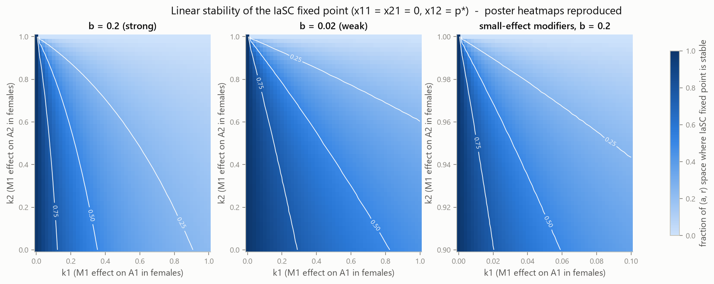
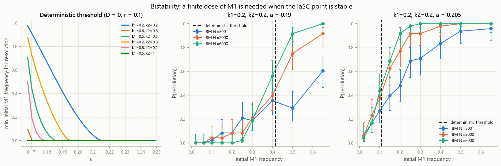
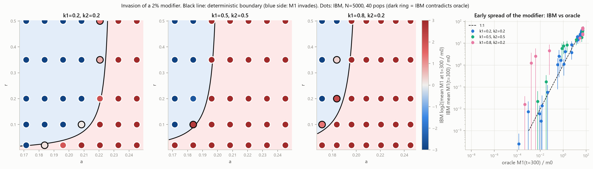
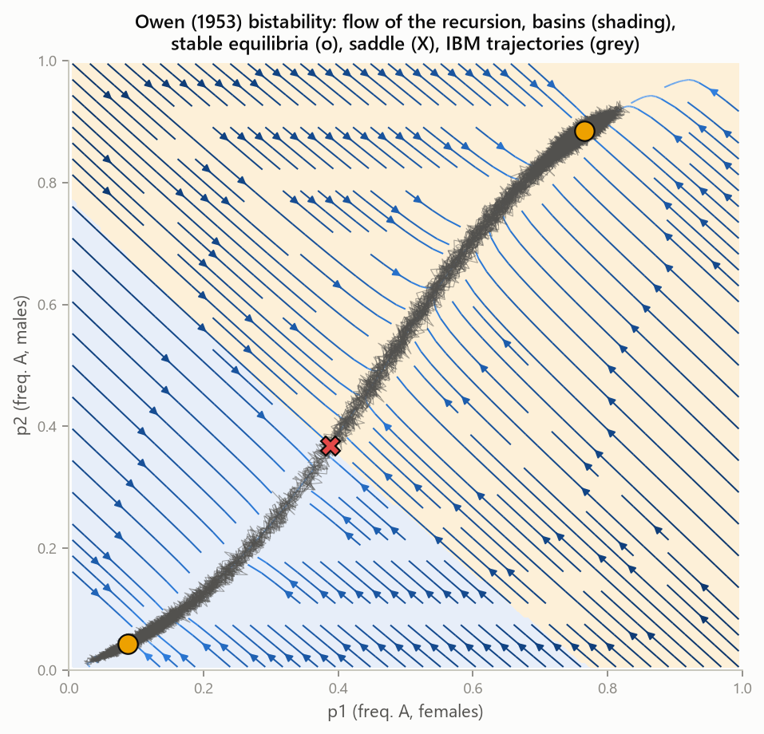
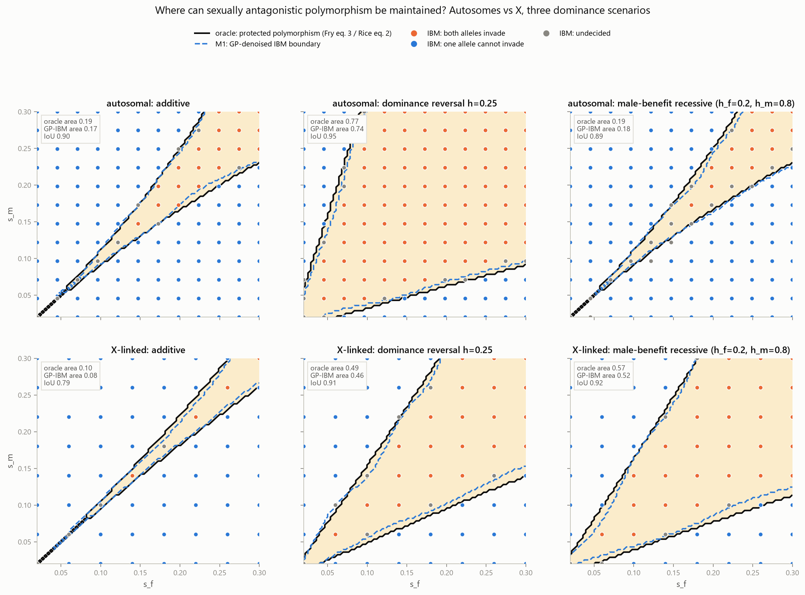
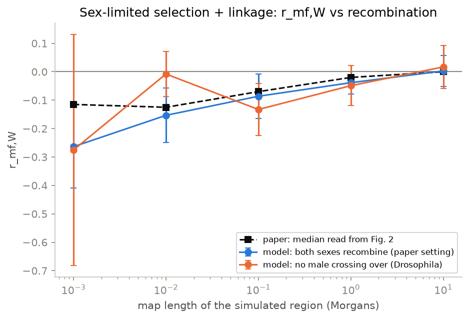
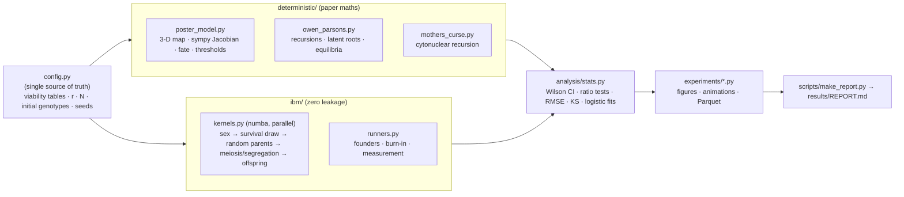

# Computational models of sexually antagonistic selection in *Drosophila* (EBL Lab, IISER Mohali)

Simulation, emulation and statistical tests of sexual-conflict theory and of published results on sexually
antagonistic selection from the Evolutionary Biology Laboratory (EBL) of Dr. N. G. Prasad, IISER Mohali.

<!-- TODO(author): add one sentence on your own role in the 2019 EBL work (position, dates).
     The repository does not record it, so it was left out rather than guessed. -->

**Sexually antagonistic (SA) selection**, also called intralocus sexual conflict (IaSC), happens when an allele
that raises fitness in one sex lowers it in the other. The repository asks two questions about it:

1. **Project 1 ([`sexconflict/`](sexconflict/)).** Do populations of simulated individuals reproduce what the
   classical deterministic models of sexual conflict predict? The populations are built only from biological
   events (survival, mating, Mendelian inheritance) and never see the equations.
2. **Project 2 ([`manas_sa/`](manas_sa/)).** Can a *Drosophila*-specific simulator of genomes, together with an
   emulation of the lab's hemiclone fitness assay, explain the EBL's measurements of the intersexual genetic
   correlation for fitness, and the different values other labs report?

| Where | What |
|---|---|
| [`reports/manual/manual.pdf`](reports/manual/manual.pdf) | **Full report and build manual** (LaTeX sources alongside): summary, worked examples, theory, build steps, results, audit, hypothesis tests, troubleshooting |
| [`results/REPORT.md`](results/REPORT.md) | Project 1 results, auto-generated from the stored run in `results/summary.json` |
| [`manas_sa/README.md`](manas_sa/README.md) | Project 2 overview, plus the optional Chinmay (2019) mate-choice, harm and telegony modules |
| [`manas_sa/docs/07_leakage_audit.md`](manas_sa/docs/07_leakage_audit.md), [`08_hypothesis_tests.md`](manas_sa/docs/08_hypothesis_tests.md) | Leakage and circularity audit; formal tests of whether the model predicts each result |
| [`manas_sa/docs/09_coupling.md`](manas_sa/docs/09_coupling.md) | Coupled model: evolved IUS genotypes (genetic layer) feed the courtship assays (assay layer) in one direction |
| [`manas_sa/docs/10_plain_language_summary.md`](manas_sa/docs/10_plain_language_summary.md) | Plain-language summary of the hypothesis tests and the coupled model |
| [`SOURCES.md`](SOURCES.md) | **Credits and licences** for every paper, dataset and tool used. Only openly licensed papers are redistributed |

---

## What was modelled

### Project 1: classical sexual-conflict theory vs. individual-based emulation

| Model | Source | Question |
|---|---|---|
| Two-locus haploid model of IaSC resolution by an expression modifier | Poster by Samant, Moitra, Sinha & Prasad, IISER Mohali (unpublished; not redistributed) | When does a modifier allele M1, which changes how the conflict allele is expressed in females, invade and resolve the conflict? |
| One-locus sex-differential viability, autosomal and X-linked | Parsons (1961); Owen (1953) | When does a new allele invade? When are there two stable equilibria? |
| "Mother's curse": male-harming mitochondrial variants | Havird *et al.* (2019) review, formalised here as a cytonuclear model | Does maternal inheritance make spread independent of the harm to males? |
| Protected SA polymorphism (autosome vs X), linkage to the sex-determining region, fixation probabilities, persistence under drift | Kidwell *et al.* (1977); Rice (1984, 1987); Fry (2010); Kimura (1962) | Where can SA polymorphism persist, and how do drift and linkage change the classical answers? |

### Project 2: EBL experiments on sexual antagonism

Five results of Manas Geeta Arun (also M. A. Samant) and colleagues ([`manas_sa/README.md`](manas_sa/README.md)):

1. Geeta Arun *et al.* 2022, *BMC Ecol Evol* 22:38. The intersexual genetic correlation for fitness
   (r<sub>w,g,mf</sub>) of 39 LH hemigenomes at three adult sex ratios. The data were collected in 2018–2019, per
   the dataset's own README
   ([`12862_2022_1992_MOESM2_ESM.txt`](experimental_papers_manas/12862_2022_1992_MOESM2_ESM.txt)).
2. Samant 2022, PhD thesis (IISER Mohali), Ch. 4: line variances and cross-sex trait–fitness covariances.
3. Geeta Arun *et al.* 2025, *Am Nat* (Robertson covariances): the paper was **not accessible** and is not assessed.
4. Geeta Arun 2025, bioRxiv ("Tie that binds"): a negative r<sub>mf,W</sub> produced by purely sex-limited
   selection plus linkage (Hill–Robertson interference, HRI).
5. Singh, Jain, Geeta Arun & Prasad 2023, bioRxiv: imperfect modifiers resolving sexual conflict, autosome vs X.

An optional extension models Temura Chinmay Krishna Yadav's BS–MS thesis (IISER Mohali, April 2019, supervisor
N. G. Prasad) on male mate choice and telegony. It is not an SA-allele study; see
[`manas_sa/docs/06_chinmay_extensions.md`](manas_sa/docs/06_chinmay_extensions.md).

---

## How the models work

### Project 1: two engines that share only the conditions

Each model is built twice:

- a **deterministic oracle** ([`sexconflict/deterministic/`](sexconflict/deterministic/)): the papers' recursions,
  with symbolic Jacobians (sympy), equilibria and invasion conditions;
- a **zero-leakage individual-based model (IBM)** ([`sexconflict/ibm/`](sexconflict/ibm/), numba-parallel). Its
  only inputs are a viability table, a crossover probability, an inheritance mode, N and the founders' genotypes.

Each IBM generation is built from events on individuals:

1. sex by a fair coin;
2. survival with probability equal to viability ÷ the sex's maximum viability;
3. each offspring picks a random surviving mother and father;
4. gametes by Mendelian segregation, with a crossover between loci with probability r;
5. maternal mitochondria; males pass on a Y, not an X.

Frequencies are only counted for the record. The test
`tests/test_smoke.py::test_ibm_never_imports_the_paper_maths` fails if any IBM module imports the oracle, `sympy`
or `scipy`. The two engines are then compared with Wilson intervals, KS tests, RMSE and logistic fits
([`sexconflict/analysis/stats.py`](sexconflict/analysis/stats.py)). The design diagram, mathematics and algorithms
are in [Technical details (Project 1)](#technical-details-project-1) below.

### Project 2: analytic layer, *Drosophila* IBM, assay emulator

- **Analytic layer** (`manas_sa/iasc/analytic/`): exact two-sex, two-locus recursions with sex-specific
  recombination, and the authors' modifier recursion (target 5).
- **IBM** (`manas_sa/iasc/ibm/`): a numba bitset Wright–Fisher simulator with *Drosophila* transmission: XX/XY,
  no crossing over in males, female crossing over, X hemizygosity in males. Mutations are sex-limited,
  sexually concordant or sexually antagonistic.
- **Hemiclone assay emulator**: samples hemigenomes the way the lab's clone-generator crosses do, expresses them in
  males and females, and computes the papers' own statistics on the simulated data.
- **Emulator** (`manas_sa/iasc/emulator/`): a Gaussian-process surrogate for sensitivity analysis and inversion.
  According to `manas_sa/README.md`, it failed validation and is not used for inference.

The assay noise is calibrated to the variances in the raw data only. A test checks that the IBM never imports the
analytic layer. The repository's own audit ([`manas_sa/docs/07_leakage_audit.md`](manas_sa/docs/07_leakage_audit.md))
separates genuine predictions from fits and from results that hold by construction.

---

## Key figures

All figures are committed outputs of the stored runs; captions summarise [`results/REPORT.md`](results/REPORT.md)
and [`manas_sa/README.md`](manas_sa/README.md).

**Poster model: where the conflict persists.** Fraction of the (a, r) parameter space in which the IaSC fixed
point is stable (a rare modifier cannot invade), as a function of the modifier's effects k1 and k2. These are the
poster's heatmaps, reconstructed from the model.



**Bistability: a finite modifier dose is needed.** Left: the oracle's minimum initial M1 frequency for resolution.
Middle and right: in the IBM the threshold becomes a sigmoid that sharpens as N grows (N = 500, 2000, 6000).



**Modifier invasion, IBM vs oracle.** Populations first reach their own IaSC state; then 2% of individuals become
M1.



**Owen-type bistability.** Flow field, the three interior equilibria, and IBM basins.



**Where SA polymorphism is protected.** Autosomal vs X-linked, for three dominance scenarios: oracle region vs
the boundary a Gaussian-process denoiser recovers from IBM outcomes alone.



**Project 2: linkage alone can make r<sub>mf,W</sub> negative.** r<sub>mf,W</sub> against the map length of the
simulated region, with and without male crossing over, next to medians read from the preprint's Fig. 2.



More figures: [`results/figures/`](results/figures/), the animations in
[`results/animations/`](results/animations/), and [`manas_sa/results/`](manas_sa/results/).

---

## Results

Only numbers that appear in the committed outputs are quoted; the source of each is given.

### Project 1 ([`results/REPORT.md`](results/REPORT.md), generated from `results/summary.json`)

- **One-locus polymorphism.** Iterating the recursion for 20,000 generations confirms the poster's
  p\* = ½ + ½(1/b − 1/a) (max deviation 6.9×10⁻⁶). The IBM's time-averaged A1 frequency has RMSE 0.125 against p\*
  at N = 500 and 0.016 at N = 5000.
- **Modifier invasion.** In 105 parameter cells, IBM verdicts were 71 spreads, 27 declines and 7 unresolved. Among
  decided cells, the direction agrees with the oracle trajectory in 99% and with the linear-stability sign in 95%.
  The one disagreeing cell has λ = 0.9978, close to neutrality.
- **Bifurcation thresholds.** For the six modifiers that invade, the reconstruction's thresholds lie about
  0.001–0.002 above the values read off the poster's plot. The seventh, (k1, k2) = (0, 0.5), never invades in either.
- **Bistability in finite populations.** The oracle threshold dose is 0.415 at a = 0.19 and 0.109 at a = 0.205. The
  IBM transition width shrinks from 0.160 to 0.044 and from 0.104 to 0.035 between N = 500 and N = 6000. Its
  midpoint is within 0.03 of the oracle threshold at N = 2000 and N = 6000.
- **Parsons/Owen.** The IBM agrees with the autosomal (eq. 2.5) and X-linked (eq. 3.6) invasion conditions in 100%
  of decided cells. For the Owen-type parameter set, the oracle finds three interior equilibria (stable, unstable,
  stable), and IBM basin agreement is 100%.
- **Mother's curse.** KS tests detect no effect of the male cost on the spread of a female-beneficial mitochondrial
  variant (p = 0.56–0.90). IBM direction verdicts agree with the oracle's twofold rule in 94% of decided cases.
- **Drift theory.** For strongly antagonistic selection, Kimura's sex-averaged fixation formula misses the IBM
  (RMSE 0.083, 0% of points within 2 SE). A diffusion built from the full sex-specific recursion fits it
  (RMSE 0.013, 86% within 2 SE).

### Project 2 ([`manas_sa/results/`](manas_sa/results/))

- **Target 1 recomputed from the authors' raw data** ([`bmc2022_recomputed.csv`](manas_sa/results/bmc2022_recomputed.csv)).
  All 12 published line-mean statistics agree with the published 4-decimal values to within 1×10⁻⁴. These include
  r<sub>w,g,mf</sub> = 0.3805 / 0.4027 / 0.2515 at male-biased / equal / female-biased sex ratios.
  `manas_sa/docs/01_source_map.md` (flag F12) notes that the match needs untransformed male proportions, although
  the paper's Methods describe an arcsine transform.
- **Target 5 (modifiers)**, re-running the authors' recursion grid
  ([`modifier_claims.csv`](manas_sa/results/modifier_claims.csv)). Of 7 published claims, 5 match in value or
  ordering. One misses in magnitude: with a perfect modifier on autosomes, 97.2% of runs fix A2B2 vs a reported
  95.7%. One does not match: autosomes resolving more than the X at very high k2.
- **Target 4 (HRI).** r<sub>mf,W</sub> is negative at the shortest map length and close to zero at 10 Morgans in
  both model variants (figure above). It rises monotonically with map length when both sexes recombine (the
  preprint's setting); without male crossing over the trend is noisier.
- **What the audit says.** The manual's plain-language summary (`reports/manual/ch0b_summary.tex`), which draws on
  the audit in `docs/07`, classifies several apparent matches as fits or as holding by construction. Examples: the simulated LH correlation comes from an architecture
  selected in a sweep, and the "SA proportion" equals (1 − r)/2 for standardised line means. See
  [`manas_sa/docs/04_comparison.md`](manas_sa/docs/04_comparison.md) for the full comparison table.

---

## Reproduce

Tested with **Python 3.14.6**. The stored results were produced on Windows 10. The steps below were also checked
on Linux x86-64.

```bash
python -m venv .venv
```

```bash
source .venv/bin/activate          # Windows: .venv\Scripts\activate
```

```bash
pip install -r requirements.txt
```

**1. Test suites of both projects.** On a 4-core Linux container this took about 1.5 minutes: 68 passed, 1
skipped. The skipped test is `tests/test_gpu.py`, which skips without an OpenCL GPU.

```bash
python -m pytest -q tests manas_sa/tests
```

**2. Quick reproduction check** (seconds; writes nothing under `results/`).
[`scripts/reproduce.py`](scripts/reproduce.py) recomputes oracle results (P0, P1, O2, O4) and runs 31 checks
against `results/summary.json`, plus one check that `results/REPORT.md` regenerates byte-for-byte. With `--ibm` it also
re-runs the P0 individual-based populations at N = 500 with the stored seeds. On Linux with the CPU backend, that
RMSE matched the stored value to 12 significant digits.

```bash
python scripts/reproduce.py --ibm
```

**3. Rebuild the reports from the stored results.** Project 1's report takes seconds. Project 2's comparison table
takes about 3 seconds; it rebuilt `comparison_table.csv` and `coverage.csv` byte-identically on Linux. It also
redraws four figures in `manas_sa/results/`, whose bytes differ between platforms.

```bash
python scripts/make_report.py
```

```bash
cd manas_sa && python scripts/make_comparison.py
```

**4. Full re-run** (slow). The stored Project 1 run's steps add up to about 87 minutes on the author's 8-CPU
machine (`results/summary.json`). Project 2's default profile takes several hours (`manas_sa/README.md`).

> **Note:** `scripts/run_all.py` writes into `results/` and overwrites the committed outputs, with
> `--profile quick` too. Restore them with `git restore results/`.

```bash
python scripts/run_all.py --profile full
```

```bash
cd manas_sa && python scripts/run_all.py --profile default
```

Options, the GPU backend and machine-sharing settings are in [How to run (details)](#4-how-to-run-details).

---

## Repository layout

```
sexconflict/            Project 1 package
  config.py             single source of truth: viability tables, N, r, profiles, seeds
  deterministic/        the papers' maths (oracle): poster_model, owen_parsons, mothers_curse, sa_classics
  ibm/                  zero-leakage individual-based model: numba kernels, optional OpenCL backend, runners
  analysis/             comparison statistics; ML helpers (GP denoiser)
  experiments/          one module per suite: poster, owen, curse, extended
scripts/                run_all.py (full pipeline), make_report.py, reproduce.py (quick check)
tests/                  zero-leakage, theory and IBM tests (Project 1)
results/                stored full run: REPORT.md, summary.json, figures/, animations/, data/
manas_sa/               Project 2 (see manas_sa/README.md): iasc/, extensions/, analysis/, scripts/, docs/, results/
reports/                LaTeX manual (compiled: reports/manual/manual.pdf) and two shorter LaTeX reports
experimental_papers_manas/, drosophila_genetics_models_papers_codes/
                        openly licensed papers and supplementary data used as inputs (SOURCES.md)
```

## Limitations

- **The poster's life cycle is inferred.** The poster does not state it; the reconstruction reproduces its p\*
  formula and invasion thresholds. The open questions for the authors are listed in
  [`results/REPORT.md`](results/REPORT.md) §5.
- **Missing sources.** Several source PDFs (the poster, Parsons, Havird, Morrow) are copyrighted and not included;
  see [`SOURCES.md`](SOURCES.md) for links.
- **Limits of Project 2,** as stated in `manas_sa/README.md` ("Not identified") and its docs:
  - the *Am Nat* 2025 paper was not accessible;
  - large population sizes are emulated by rescaling (`manas_sa/docs/03_parameters.md`);
  - the model cannot identify the LH population's true mutational architecture or say whether the sex-ratio
    effect is attenuation or a real genotype × sex-ratio change; see also
    [`manas_sa/docs/05_limits_and_distinguishing_experiment.md`](manas_sa/docs/05_limits_and_distinguishing_experiment.md).

## Credits and licence

All credit for the experiments, data and original theory belongs to the authors cited in
[`SOURCES.md`](SOURCES.md). The MIT licence in [`LICENSE`](LICENSE) covers this repository's own code,
documentation and generated results. Third-party papers and data keep their own licences.

---

## Technical details (Project 1)

This part rebuilds the models behind the documents listed below. For each one it asks whether a population of
simulated organisms, built only from biological primitives, produces the patterns the mathematics predicts.

| Source document | What it contains | What we built |
|---|---|---|
| `Poster_Manas.pdf`: Samant, Moitra, Sinha & Prasad (IISER Mohali), *A two-locus haploid model for the resolution of intra-locus sexual conflict* | 3-D iterative map, linear stability, bifurcation and basin analyses | **Full reconstruction** of every panel, plus an IBM counterpart for each |
| `Parsons(1961).pdf` (same file as `P.A. Parsons.pdf`): *Initial progress of new genes with viability differences between sexes and with sex linkage* | Latent-root invasion conditions (2.5), (2.6), (3.6), (4.1) | Oracle + IBM for the autosomal and X-linked cases; Owen's (1953) two stable equilibria |
| `PIIS0960982219303185.pdf`: Havird et al. 2019, *Selfish mitonuclear conflict* (review) | Verbal theory: "mother's curse", the twofold rule, restorers | Formalised as a cytonuclear model, with an IBM |
| `Morrow et al (2002) Behavioural Ecology.pdf` | Insect harm experiments (ANOVA) | No model to simulate; used as biological context only |
| `Simulating Population Genetics Models.txt` | An earlier prompt plus an AI blueprint for Owen/Mandel (1971) | Design principles adopted (zero leakage, smoke tests, KS/RMSE, phase portraits); its Mandel cubic is **verified** numerically |

The PDFs in this table are not included (copyright); see [`SOURCES.md`](SOURCES.md).

Results: [`results/REPORT.md`](results/REPORT.md) (auto-generated), figures in `results/figures/`, GIFs in
`results/animations/`, data in `results/data/` (Parquet / npz), run metadata in `results/summary.json`.

### 1. Design: two engines that share only conditions



**The zero-leakage contract** is enforced by `tests/test_smoke.py::test_ibm_never_imports_the_paper_maths`.
- The IBM never imports `deterministic/`, `sympy` or `scipy`.
- It never evaluates a recursion, an equilibrium (not even p*: its populations reach their own IaSC state in a
  burn-in), an eigenvalue, or an expected frequency.
- It receives only a **viability table**, a **crossover probability**, an **inheritance mode**, **N**, and the
  **initial genotypes of individuals**.
- Each generation is built from events on individuals:
  1. Every individual is assigned a sex by a fair coin.
  2. Each individual survives with probability equal to its viability ÷ the largest viability in its sex.
  3. Each of N offspring picks a uniformly random surviving mother and father.
  4. Gametes form by Mendelian segregation, with a crossover between loci with probability r.
  5. Mitochondria come from the mother; males pass on a Y, not an X.
- Frequencies are only *counted* for the record.

### 2. Mathematics

#### 2.1 Poster model (two-locus, haploid selection, dioecious, random mating)

Haplotypes x = (x11, x12, x21, x22) = (A1M1, A1M2, A2M1, A2M2). Their fitnesses:

| | A1M1 | A1M2 | A2M1 | A2M2 |
|---|---|---|---|---|
| males | 1+a | 1+a | 1 | 1 |
| females | 1+b·k1 | 1 | 1+b·k2 | 1+b |

**Life cycle (reconstructed).** The poster does not state it. The cycle below is the one that reproduces the
poster's p* formula exactly:

1. Haploid offspring have the same haplotype frequencies in both sexes.
2. Selection acts in each sex: m_ij = x_ij·w^m_ij / w̄_m and f_ij = x_ij·w^f_ij / w̄_f.
3. A female and a male haplotype unite at random, then meiosis recombines them with probability r:

  x'_ij = ½(1−r)(f_ij + m_ij) + ½ r (f_{A_i}·m_{M_j} + m_{A_i}·f_{M_j})

Here f_{A_i} and m_{M_j} are the allele marginals after selection.

**One-locus IaSC.**
- Recursion: p' = ½[p(1+a)/(1+ap) + p/(1+b(1−p))].
- Fixed points satisfy p·[2ab p² − (a−b+3ab)p + (a−b+ab)] = 0, whose roots are p = 0, p = 1 and
  **p\* = (ab+a−b)/(2ab) = ½ + ½(1/b − 1/a)**, exactly as on the poster.
- p\* is interior iff **−1 < 1/b − 1/a < 1**, i.e. a ∈ (b/(1+b), b/(1−b)). For b = 0.2 that is a ∈ (1/6, 1/4),
  the poster's a-axis.
- The restoring eigenvalue dp'/dp at p\* lies in [0.992, 0.99997] for b = 0.2. The polymorphism is stable, but
  only weakly, especially near the edges. Section 4 of the report shows why this matters.

**Invasion of the modifier.** The face x11 = x21 = 0 is invariant, so at the IaSC point (0, p\*, 0) the
Jacobian is block-triangular:

  J = [[B, 0], [·, μ]]   in the ordering (x11, x21 | x12)

Its eigenvalues are therefore μ (the one-locus restoring eigenvalue) and those of the 2×2 matrix B.
**M1 invades ⇔ ρ(B) > 1.**

The Jacobian is derived symbolically with sympy (no hand algebra) and checked against finite differences.
We also give a hand-derived closed form, tested to agree with sympy to 1e-12. It uses
W_m = 1+ap\*, W_f = 1+b(1−p\*), φ_m = p\*(1+a)/W_m, φ_f = p\*/W_f, and
α = (1+a)/W_m, γ = 1/W_m, β_1 = (1+bk1)/W_f, β_2 = (1+bk2)/W_f:

```
B11 = ½(1−r)(β1+α) + ½r(φf·α + φm·β1)        B12 = ½r(φf·γ + φm·β2)
B21 = ½r((1−φf)α + (1−φm)β1)                 B22 = ½(1−r)(β2+γ) + ½r((1−φf)γ + (1−φm)β2)
```

What this explains:
- **r → 0:** the eigenvalues become 1 + bk1/(2W_f) and 1 − b(1−k2)/(2W_f). Any k1 > 0 invades on the A1
  background. This is the thin unstable strip along r ≈ 0 in the poster's (a, r) panels.
- **Recombination** mixes M1 onto A2, where it costs b(1−k2). So **lower r favours resolution** (poster
  result 4). A larger a raises p\*, putting more M1 on A1 (poster result 3).

**Global questions** are answered by vectorised iteration of the map (`fate`):
- the bifurcation diagrams;
- the minimum M1 dose, found by bisection;
- the basins, from Dirichlet(1,1,1,1) initial conditions.

#### 2.2 Parsons (1961) / Owen (1953)

**Autosomal.** Females have viabilities (a1, h1, b1) for AA, Aa, aa; males have (a2, h2, b2).
- Recursion: p_i' = [a_i p1p2 + ½h_i(p1q2+p2q1)] / [a_i p1p2 + h_i(p1q2+p2q1) + b_i q1q2].
  The ½ is lost in the OCR of the scan.
- Linearised at p = 0: the dominant latent root is **λ = ½(h1/b1 + h2/b2)**. So A invades iff
  **h1b2 + h2b1 > 2b1b2** (eq. 2.5), which is ≈ β1 + β2 > 0 for small effects (eq. 2.6).

**X-linked.**
- Males: p2' = a2p1/(a2p1+b2q1).
- The characteristic equation λ² − (h1/2b1)λ − h1a2/(2b1b2) = 0 gives the exact invasion condition
  **h1(a2+b2) > 2b1b2**, which is ≈ 2β1 + β2 − α2 > 0 (eq. 3.6).
- The scan shows the "note added in proof" as h1(a2+b2) > b1b2. A factor of 2 is needed for consistency
  with (3.6), so we read its absence as a scan artefact.

**Equilibria** are found numerically: solve the female equation for u2(u1), then root-bracket the male residual,
with u = p/q. The cubic attributed to Mandel (1971) in the AI blueprint gives the same equilibria in all
4,000 random parameter sets tested.

#### 2.3 Mother's curse (Havird et al. 2019), formalised

The state is the zygote distribution Z[c, g], where c is the mito type (maternal) and g ∈ {0, 1, 2} is the
number of copies of a nuclear restorer R.

- Females: (1+s_f·c)(1−cost·d(g)).
- Males: (1 − s_m·c·(1 − restore·d(g)))(1−cost·d(g)), with dominance d = (0, h, 1).

Derived predictions:
- **Strong form.** The rare-mito growth factor is 1+s_f, independent of s_m.
- **Twofold rule.** For a nuclear allele with the same effects, Parsons' root gives λ = ½(w_f,het + w_m,het).
  With sterile males (w_m = 0), invasion needs w_f > 2. This is the review's "at least twofold" statement, and
  it is a special case of Parsons' eq. 2.5.
- **Weak form.** With s_f = 0 the variant is neutral, so P(fix) = initial frequency for every s_m.

#### 2.4 Extended suite: classical sexual-antagonism theory and drift theory (`deterministic/sa_classics.py`)

| ID | Proven result tested | Oracle | IBM |
|---|---|---|---|
| E1 | Kidwell et al. 1977 / Fry 2010 eq. 3: autosomal protected polymorphism | latent roots at both boundaries ≡ Fry eq. 3 (checked in 20k random sets) | two rare-invasion experiments per (s_f, s_m) cell |
| E2 | Rice 1984 eq. 2 vs Fry 2010: X-linked vs autosomal | X-linked latent roots ≡ Rice eq. 2 | X-linked kernel |
| E3 | Kimura 1962 fixation probability | sex-averaged Kimura; **full diffusion u(p) = ∫ψ/∫ψ** with drift M(p) from the complete recursion; haploid formula with Ne = N/2 for mito | thousands of populations (GPU) |
| E4 | Rice 1987: SA locus linked to the sex-determining region | new two-locus recursion (A1 on X in eggs, X-sperm, Y-sperm; crossover r) | new kernel with **genetic sex determination** (sex = inherited Y) |
| E5 | Backward Kolmogorov mean absorption time | finite-difference solver, ½V T″ + M T′ = −1 | time until the IaSC polymorphism is lost |

**Fitness scheme** (Kidwell/Rice/Fry). A1 is male-beneficial.

| | A1A1 | A1A2 | A2A2 |
|---|---|---|---|
| males | 1 | 1 − h_m·s_m | 1 − s_m |
| females | 1 − s_f | 1 − h_f·s_f | 1 |

X-linked males: A1 → 1, A2 → 1 − s_m.

**ML, analysis layer only; nothing feeds back into the IBM**

- **M1. GP denoiser.** Heteroscedastic Gaussian-process regression on tanh(½·log invasion ratio), fitted to IBM
  outcomes only. The length scale is bounded below by the grid spacing, and the sampling variance is floored. The
  emergent region is compared with the oracle by IoU.
- **M2. Neural emulator** (MLP), trained on IBM fixation data for N ≤ 600 and tested on N = 800.
  - Generic inputs (log N, s) fail to extrapolate.
  - The diffusion scaling variable N·s extrapolates. The IBM data therefore exhibit Kimura's Ns data collapse.
- **M3. Inverse problem.** Recover (s_f, s_m) from one IBM trajectory, either with an amortised MLP trained on IBM
  simulations or by a least-squares fit of the oracle recursion.
- **Tuner (E5).** The IBM's effective size, measured from its own one-step fluctuations, is fed into the diffusion
  theory.

### 3. Algorithms (per experiment)

| ID | Oracle | IBM | Comparison |
|---|---|---|---|
| P0 | p\* formula + iterated recursion | burn-in from 50 % A1, time-averaged frequency | RMSE vs N |
| P1 | ρ(B) on a 101×101 (a, r) grid for each (k1, k2) → fraction stable | – | vs poster heatmaps |
| P2 | stable/unstable map; trajectory from (p\*, m0 = 2 %, D = 0) | burn-in → mutate 2 % of individuals to M1 → 300 generations | sign of mean change (95 % CI) vs oracle; IBM-vs-oracle ratio scatter |
| P2c | restoring eigenvalue μ(a) | fraction of populations still polymorphic after T | drift erosion vs μ |
| P3 | `fate` from near / away initial conditions | ensemble means | overlay |
| P4 | bisection for the minimum M1 dose | P(resolution) vs dose, three N | logistic midpoint vs threshold |
| P5 | Dirichlet initial conditions → basin fraction | the same initial conditions as founders | per-initial-condition agreement |
| P6 | trajectory | ensembles over N | RMSE, between-population SD ∝ N^−½ |
| P7 | trajectories | animated populations | fate agreement |
| O1/O3 | latent root; trajectory from the founding dose | 20 founding copies | ratio test + establishment map |
| O2 | Parsons' worked example | 64 populations | equilibrium match |
| O4 | flow field (streamplot), equilibria, basins | grid of starts + animation | basin agreement |
| C1–C4 | cytonuclear recursion | IBM with maternal mito | endpoint KS, threshold, P(fix), arms race |

### 4. How to run (details)

Commands are shown with `python` from an activated virtual environment (see [Reproduce](#reproduce)).

```bash
python -m pytest -q tests
```

```bash
python scripts/run_all.py --profile full
```

```bash
python scripts/make_report.py
```

- `--profile quick` runs everything in a few minutes for smoke testing; `--only poster,owen,curse` selects suites.
- `--steps P4,P5,O` reruns only the steps whose id starts with one of those prefixes; earlier results in
  `summary.json` are kept.
- **Machine sharing.** Runs default to `cpu_count − 2` numba threads at below-normal priority, so other work on
  the machine stays responsive. Override with the `SC_THREADS` environment variable.

#### GPU backend (optional, AMD/any OpenCL GPU)

```bash
pip install -r requirements-gpu.txt
```

```bash
python scripts/run_all.py --profile full --backend opencl
```

```bash
python -m pytest -q tests/test_gpu.py
```

**What was available on the author's machine**
- ROCm/HIP, CuPy, JAX-GPU and CUDA are not available: AMD's Windows ROCm does not support the Radeon RX 560X
  (Polaris).
- **OpenCL works** with both GPUs: the RX 560X ("Baffin", 16 compute units, 4 GB) and the Vega 8 iGPU.

**How the GPU kernels work** (`sexconflict/ibm/opencl_backend.py`)
- They implement the same biological primitives as the CPU kernels.
- One work-item per individual draws its sex and survival; one work-item per offspring draws its parents.
- Parents are drawn by rejection sampling among survivors, which is exactly uniform over the survivors.
- Random numbers come from a counter-based hash, so runs are reproducible.
- Results are statistically equivalent to the CPU kernels, not bit-identical. `tests/test_gpu.py` checks this
  with 400 replicate populations per comparison.
- Select the device with `SC_GPU_DEVICE=Baffin` (default: the GPU with the most compute units).
- The X-linked kernel stays on the CPU.

**Measured throughput on the author's machine (individual-generations per second)**

| | Throughput |
|---|---|
| CPU (numba, 8 threads) | ≈3.8×10⁷ |
| RX 560X, large ensembles | 2.7–3.8×10⁸ (**7–10×**) |
| RX 560X, small ensembles | ≈6×10⁷ (limited by kernel-launch overhead) |

**Deterministic speed-up.** `poster_model.fate_fast` is a numba-compiled, per-element-stopping version of the map
iteration, about 8× faster than numpy. A regression test checks it against a fully converged numpy reference.
- Seeds are derived from `MASTER_SEED` and each experiment's name (`config.seed_for`), so any single experiment
  reproduces bit-for-bit on its own. Numba's per-thread RNG is reseeded per replicate.
- Library choices:
  - **numba** (parallel `prange`, about 4×10⁷ individual-generations/s on 8 cores) for the IBM;
  - **sympy** for exact Jacobians (JAX is not available for this Windows/Python 3.14 combination);
  - **numpy** broadcasting for vectorised maps;
  - **scipy** for root-finding and statistics;
  - **pandas/pyarrow** for Parquet;
  - **matplotlib** for static figures, streamplots and GIF animations (Pillow writer).
